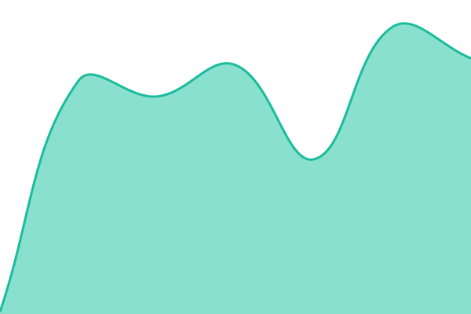

# [📈 Live Status](https://status.lera.link): <!--live status--> **🟩 All systems operational**

This repository contains the open-source uptime monitor and status page for [SSStudio Github](https://ssstudio.studio), powered by [Upptime](https://github.com/upptime/upptime).

With [Upptime](https://upptime.js.org), you can get your own unlimited and free uptime monitor and status page, powered entirely by a GitHub repository. We use [Issues](https://github.com/SSStudio-Git/lera-status/issues) as incident reports, [Actions](https://github.com/SSStudio-Git/lera-status/actions) as uptime monitors, and [Pages](https://status.lera.link) for the status page.

<!--start: status pages-->
<!-- This summary is generated by Upptime (https://github.com/upptime/upptime) -->
<!-- Do not edit this manually, your changes will be overwritten -->
<!-- prettier-ignore -->
| URL | Status | History | Response Time | Uptime |
| --- | ------ | ------- | ------------- | ------ |
|  [LeraLink](https://hub.lera.link/) | 🟩 Up | [lera-link.yml](https://github.com/SSStudio-Git/lera-status/commits/HEAD/history/lera-link.yml) | 

 5612ms
     
 | 

<a href="https://status.lera.link/history/lera-link">100.00%</a>
    

|  [LeraLink API](https://hub.lera.link/api/health) | 🟩 Up | [lera-link-api.yml](https://github.com/SSStudio-Git/lera-status/commits/HEAD/history/lera-link-api.yml) | 

 1045ms
     
 | 

<a href="https://status.lera.link/history/lera-link-api">100.00%</a>
    

|  [Sajad Sepehri](https://sajadsepehri.com/) | 🟩 Up | [sajad-sepehri.yml](https://github.com/SSStudio-Git/lera-status/commits/HEAD/history/sajad-sepehri.yml) | 

 750ms
     
 | 

<a href="https://status.lera.link/history/sajad-sepehri">100.00%</a>
    

|  [Sajad Sepehri API](https://sajadsepehri.com/api/health) | 🟩 Up | [sajad-sepehri-api.yml](https://github.com/SSStudio-Git/lera-status/commits/HEAD/history/sajad-sepehri-api.yml) | 

 790ms
     
 | 

<a href="https://status.lera.link/history/sajad-sepehri-api">100.00%</a>
    

|  [Platform administration](https://admin.lera.link/api/health) | 🟩 Up | [platform-administration.yml](https://github.com/SSStudio-Git/lera-status/commits/HEAD/history/platform-administration.yml) | 

 104ms
     
 | 

<a href="https://status.lera.link/history/platform-administration">100.00%</a>
    

|  [Sajad Sepehri administration](https://admin.sajadsepehri.com/api/health) | 🟩 Up | [sajad-sepehri-administration.yml](https://github.com/SSStudio-Git/lera-status/commits/HEAD/history/sajad-sepehri-administration.yml) | 

 107ms
     
 | 

<a href="https://status.lera.link/history/sajad-sepehri-administration">100.00%</a>
    

<!--end: status pages-->

[**Visit our status website →**](https://status.lera.link)

## 📄 License

- Powered by: [Upptime](https://github.com/upptime/upptime)
- Code: [MIT](./LICENSE) © [Anand Chowdhary](https://anandchowdhary.com)
- Data in the `./history` directory: [Open Database License](https://opendatacommons.org/licenses/odbl/1-0/)
